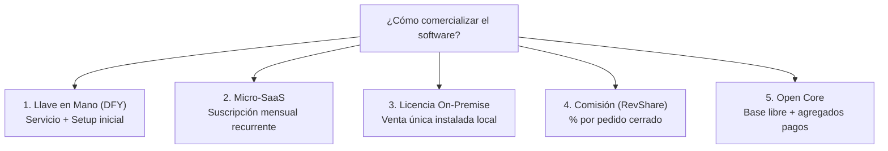
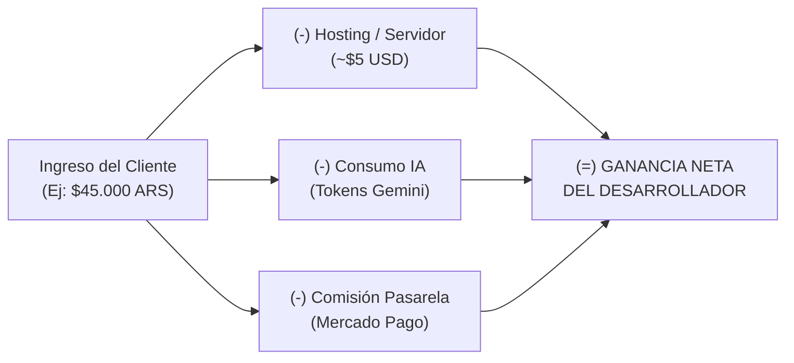
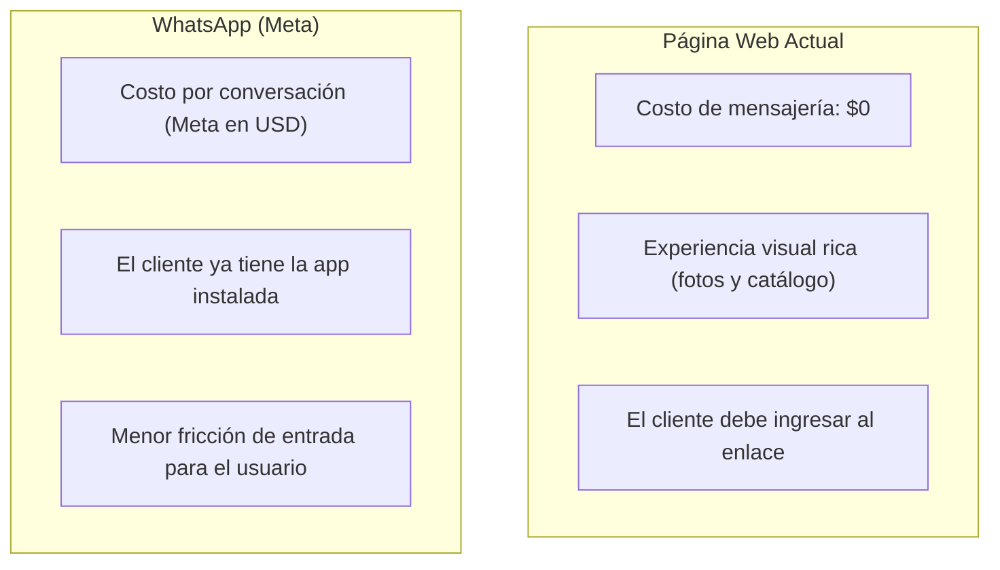
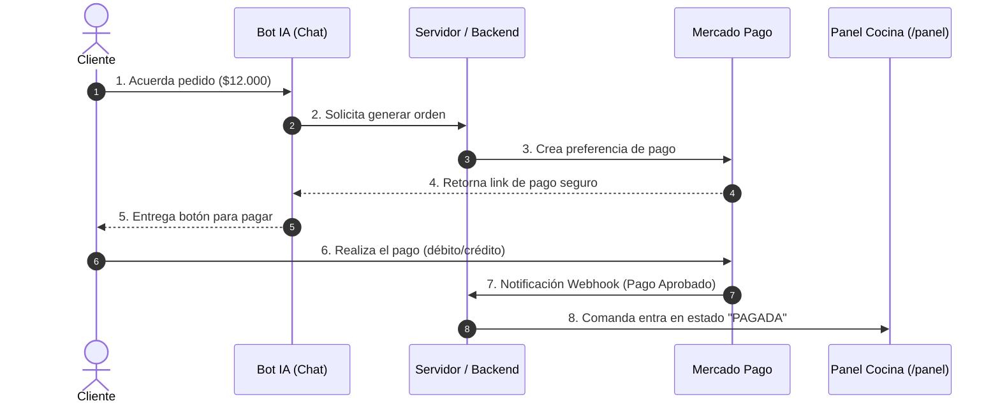

# Guía de Comercialización de Software con Inteligencia Artificial

> **Objetivo de este documento:**  
> Explicar de forma sencilla, práctica y pedagógica cómo un proyecto de software real —como nuestra aplicación de comercio con Inteligencia Artificial para pastelería— puede convertirse en un negocio rentable. 
> Aprenderás las formas de venderlo, cuánto se puede cobrar y qué costos técnicos hay que tener en cuenta.

---

## 1. El Caso de Estudio: ¿Qué construimos?

Para entender cómo vender un producto, primero debemos tener claro qué problema resuelve.

Imaginemos nuestro proyecto:
* **Catálogo online:** El cliente ve tortas, tartas y postres con precios y fotos desde el celular o la computadora.
* **Asistente inteligente ("DulceBot"):** Un chat impulsado por Inteligencia Artificial (Gemini) que asesora al cliente, calcula porciones según la cantidad de invitados, anota dedicatorias personalizadas y arma el pedido solo.
* **Panel de cocina (`/panel`):** Una pantalla para el pastelero donde entran los pedidos en tiempo real con sus detalles para comenzar a cocinar.

**El valor para el cliente del negocio:**  
El pastelero ya no pasa horas respondiendo mensajes repetitivos por WhatsApp ni anotando pedidos a mano en una libreta con riesgo de equivocarse.

---

## 2. Conceptos Clave (Glosario Rápido)

Antes de hablar de dinero, definamos cuatro términos esenciales sin tecnicismos complicados:

* **SaaS (Software as a Service / Software como Servicio):**  
  En lugar de vender el programa para que el cliente lo instale en su computadora, se lo "alquilás" a través de internet por una cuota mensual. Ejemplo cotidiano: *Netflix* o *Spotify*.
* **On-Premise (Instalación Local / Venta por Licencia):**  
  El cliente compra el programa una sola vez y se instala directamente en su computadora o servidor. Ejemplo clásico: comprar la caja de *Windows* o un videojuego físico.
* **Llave en Mano (Done-For-You / Servicio integral):**  
  El cliente no sabe ni quiere saber nada de tecnología. Vos te encargás de todo: instalás el sistema, cargás sus productos, le sacás las fotos y se lo entregás funcionando listo para usar.
* **Token de IA:**  
  Es la unidad de medida con la que cobran los modelos como ChatGPT o Google Gemini. Un token equivale aproximadamente a una palabra o fragmento de palabra. Cada vez que el bot responde, consume tokens que tienen un costo en dólares.

---

## 3. Las 5 Formas de Vender este Software

A continuación, comparamos las distintas alternativas para ofrecer este sistema al mercado:

### Modelo 1: Llave en Mano / "Done-For-You" (El más recomendado para empezar)
* **¿Cómo funciona?**  
  Vas a una pastelería local y le decís al dueño: *"Te digitalizo todo el negocio: cargo tus 30 tortas, configuro el bot con los gustos de tu clientela y te dejo una pantalla en la cocina para recibir pedidos"*.
* **¿Qué cobrás?**  
  1. Un cobro inicial por la puesta en marcha (Setup).  
  2. Un abono mensual pequeño para mantener la web activa y dar soporte si algo falla.
* **Ventajas:**  
  Muy fácil de vender a comerciantes de barrio que no saben de computación. Cobrás dinero importante desde el primer día.
* **Desventajas:**  
  Lleva tiempo manual: por cada cliente tenés que sentarte a configurar su menú.

---

### Modelo 2: Micro-SaaS (Suscripción mensual)
* **¿Cómo funciona?**  
  Creás una plataforma web (ejemplo: `mirestaurante.com`) donde cualquier pastelero entra, se crea una cuenta, sube sus fotos y empieza a usar el bot pagando una cuota fija al mes.
* **¿Qué cobrás?**  
  Una suscripción mensual recurrente (ej: Plan Básico \$35.000 ARS/mes, Plan Avanzado \$60.000 ARS/mes).
* **Ventajas:**  
  Ingresos predecibles todos los meses. Si conseguís 50 clientes, cobrás todos los meses sin tener que hacer el software de nuevo 50 veces.
* **Desventajas:**  
  Requiere adaptar el código para que muchos clientes usen la misma base de datos de forma segura sin mezclarse (arquitectura multi-inquilino o *multi-tenant*).

---

### Modelo 3: Venta de Licencia (On-Premise)
* **¿Cómo funciona?**  
  Le entregás el software empaquetado al cliente para que funcione en la computadora de su local. Los datos nunca salen de su negocio.
* **¿Qué cobrás?**  
  Un único pago fuerte al inicio. Opcionalmente, un abono anual si quiere actualizaciones y asistencia técnica.
* **Ventajas:**  
  Cobro grande de golpe. Les gusta a negocios celosos de su información que no confían en la "nube".
* **Desventajas:**  
  Si no te contratan soporte, no volvés a ver ingresos de ese cliente. Además, si se le rompe la computadora local, tenés que ir a asistirlo físicamente o por control remoto.

---

### Modelo 4: Comisión por Venta (RevShare)
* **¿Cómo funciona?**  
  No le cobrás casi nada fijo al comerciante. En cambio, cobrás un porcentaje pequeño (por ejemplo, el 2% o 3%) de cada pedido que se concrete a través del asistente de IA.
* **Ventajas:**  
  Fácil de convencer al cliente: *"Si no vendés nada, no me pagás nada"*. Las aplicaciones como PedidosYa cobran entre el 15% y el 25%, por lo que una comisión del 2% al 3% le parece una ganga.
* **Desventajas:**  
  Obliga a integrar una pasarela de pago como Mercado Pago de forma obligatoria para poder descontar la comisión automáticamente antes de que la plata llegue al pastelero.

---

### Modelo 5: Open Core / Código Abierto con Módulos Premium
* **¿Cómo funciona?**  
  Liberás la versión básica en GitHub gratis (el catálogo y la comandera). Los clientes o programadores pueden probarlo libremente. Si quieren la conexión oficial con WhatsApp o reportes avanzados de facturación con gráficos, pagan por esos "agregados".
* **Ventajas:**  
  Mucha difusión y reconocimiento profesional en la comunidad tecnológica.
* **Desventajas:**  
  Los comerciantes gastronómicos tradicionales no saben qué es GitHub ni van a instalar código por su cuenta.

---

## 4. Cuadro Comparativo: Precios de Referencia

Para tener noción de valores reales de mercado (estimados para el sector gastronómico PyME):

| Modelo | En el Mundo (Dólares USD) | En Argentina (Pesos ARS) | Tipo de Cobro |
| :--- | :--- | :--- | :--- |
| **Llave en Mano (Setup inicial)** | \$350 a \$800 USD | \$200.000 a \$450.000 ARS | Pago único al inicio |
| **Abono de mantenimiento mensual** | \$30 a \$60 USD/mes | \$35.000 a \$65.000 ARS/mes | Mensual recurrente |
| **SaaS Autónomo (Autoservicio)** | \$29 a \$49 USD/mes | \$30.000 a \$50.000 ARS/mes | Mensual recurrente |
| **Venta de Licencia Única** | \$800 a \$1.500 USD | \$500.000 a \$950.000 ARS | Pago único |
| **Comisión por Pedido** | 2% a 4% del ticket | 1.5% a 3% del ticket | Por cada venta cerrada |

---

## 5. ¿Qué Costos Ocultos Hay que Tener en Cuenta?

No todo lo que cobramos es ganancia limpia. Al usar Inteligencia Artificial y servidores existen gastos operativos que todo desarrollador debe presupuestar:

1. **Costo de la IA (Tokens de Google Gemini):**  
   Cada conversación cuesta fracciones de centavo de dólar. Por ejemplo, con modelos rápidos como Gemini Flash, atender 500 pedidos al mes puede costar menos de \$1 a \$2 USD. Sin embargo, hay que poner límites de seguridad para evitar que un usuario malintencionado se ponga a hablar horas de cualquier tema y gaste saldo innecesariamente.
2. **Costo del Servidor (Hosting):**  
   Mantener la aplicación funcionando las 24 horas en un servidor en la nube cuesta entre \$4 y \$10 USD mensuales en proveedores básicos.

---

## 6. Web vs. WhatsApp: ¿Dónde Conviene que Viva el Bot?

En nuestra aplicación actual, el bot vive como un widget flotante en una página web. Sin embargo, en Latinoamérica y especialmente en Argentina, más del 80% de los pedidos de pastelerías y rotiserías ocurren por WhatsApp.

¿Qué cambia si decidimos llevar este asistente a WhatsApp?

### ¿Cómo cobra Meta (WhatsApp Oficial)?
Meta no cobra por cada mensaje suelto, sino por **ventanas de conversación de 24 horas**:
* **Conversación de servicio:** Si el cliente le escribe primero a la pastelería para pedir información, se abre una ventana de 24 horas donde el bot puede responder libremente. Meta cobra una tarifa pequeña por esa sesión (aproximadamente entre **\$0.03 y \$0.05 USD** por conversación iniciada por el cliente).
* **Conversación de marketing / iniciada por el negocio:** Si la pastelería quiere enviarle un mensaje proactivo al cliente (ej: *"¡Ya tenemos roscas de pascua disponibles!"*), el costo es más alto (alrededor de **\$0.06 a \$0.09 USD**).

### El Dilema Técnico y Comercial:
1. **Ruta Oficial (WhatsApp Cloud API):**
   * *Ventaja:* 100% legal, no hay riesgo de que Meta bloquee el número del local.
   * *Desventaja:* Tiene costo variable en dólares que debés trasladar al abono mensual del cliente o cobrar un límite de conversaciones.
2. **Ruta No Oficial (Librerías de emulación como Baileys / Evolution API):**
   * *Ventaja:* Costo de mensajería \$0.
   * *Desventaja:* Riesgo permanente de que WhatsApp detecte tráfico automatizado y bloquee el número de teléfono del comercio. **Peligroso para venderlo profesionalmente.**

> **Recomendación pedagógica:** Para comenzar a validar, la **página web** es la mejor opción porque tiene costo cero de mensajería. Una vez que el comercio factura y tiene volumen, se da el salto a WhatsApp oficial como un paquete "Premium".

---

## 7. Cobros Automáticos con Mercado Pago: ¿Cómo Cerrar la Venta?

Actualmente, nuestro panel `/panel` recibe el pedido en estado "Pendiente", pero no garantiza que el cliente haya pagado. En el comercio real, si el pastelero empieza a hornear una torta personalizada sin una seña o el pago total, corre el riesgo de perder mercadería.

### ¿Cómo se integra el cobro en el flujo conversacional?

El proceso sigue un ciclo de 4 pasos:

1. **El Asistente confirma el pedido:** Cuando el cliente dice *"Quiero confirmar el pedido"*, el backend se comunica con la API de Mercado Pago.
2. **Link de Pago (Checkout Pro):** El bot le entrega al usuario un botón o link seguro para pagar (con dinero en cuenta de Mercado Pago, débito o crédito).
3. **Confirmación automática (Webhooks):**  
   *¿Cómo sabe nuestro sistema que el cliente efectivamente pagó?*  
   A través de un **Webhook** (un aviso automático entre servidores). Cuando el pago se acredita, Mercado Pago le "avisa" silenciosamente a nuestro servidor en segundo plano: *"El pedido #104 fue abonado con éxito"*.
4. **La comanda pasa a producción:** El estado en el `/panel` cambia automáticamente de "Pendiente de pago" a "Listo para preparar".

### Comisiones de Mercado Pago (A tener en cuenta en los costos)
Mercado Pago retiene una comisión por procesar el dinero:
* **Con dinero en cuenta o débito inmediato:** Aprox. **0.8% a 1.5% + IVA**.
* **Con tarjeta de crédito (liberación en el momento):** Aprox. **6% + IVA**.
* **Con tarjeta de crédito (liberación a 14 o 30 días):** Entre **1.5% y 3.5% + IVA**.

> **Regla de oro para el desarrollador:**  
> La cuenta de Mercado Pago debe ser siempre **del dueño del local**, no tuya. El dinero de las tortas ingresa directo a la cuenta del comerciante, y vos le cobrás tu abono o comisión mensual por separado mediante factura de servicios.

---

## 8. Pasos para Salir a Vender (Metodología Recomendada)

Para quien da sus primeros pasos comerciales con este proyecto:

1. **Paso 1: Conseguir el "Cliente Cero" (Prueba Piloto):**  
   Buscá una pastelería, rotisería o cafetería conocida. Ofreceles instalarles el sistema gratis o a precio de costo durante 30 días a cambio de que lo usen todos los días y te digan qué hay que mejorar.
2. **Paso 2: Medir Resultados Reales:**  
   Anotá métricas concretas: *"El bot atendió 45 pedidos en un fin de semana y le ahorró al dueño 6 horas de responder mensajes"*.
3. **Paso 3: Venta con Resultados Comprobados:**  
   Con esos números en mano, el siguiente cliente no compra "tecnología que no entiende", sino una solución que ya demostró ahorrar tiempo y aumentar ventas.
